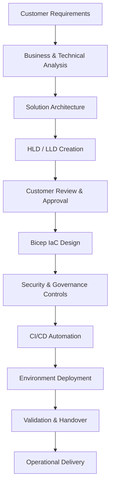
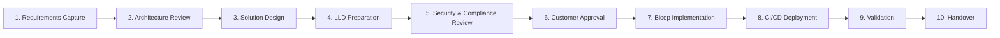
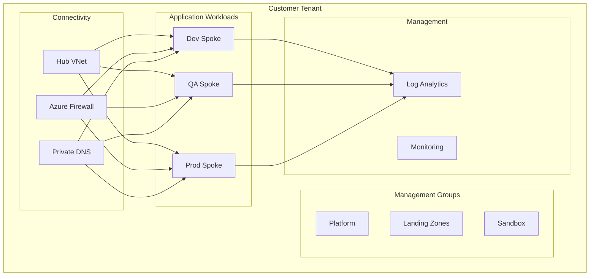

# Azure Architect Planning Document

# 1. Executive Summary

This document translates the provided job description into a structured architecture and delivery plan for an Azure solution. It is designed to help an Azure Architect prepare for customer-facing design work, solution planning, low-level design (LLD) creation, and implementation using Bicep-based Infrastructure as Code (IaC).

The objective is to align the solution with enterprise Azure landing zone principles, security guardrails, networking, identity, monitoring, and hands-on implementation standards expected in a real delivery environment.

---

## 2. Role Objective

The Azure Architect is expected to:

- understand customer requirements and translate them into secure Azure architecture
- produce architecture decisions and LLD documents
- validate design choices with stakeholders and secure customer approval
- implement environments using Bicep and CI/CD automation
- ensure compliance, governance, and operational readiness for delivery teams

This role sits at the intersection of solution design, engineering, governance, and customer communication.

---

## 3. Architecture Planning View

---

## 4. Key Responsibilities Mapped to Planning

| Responsibility | Planning Meaning | What the Architect Must Do |
|---|---|---|
| Design Azure architectures | Define the target state | Create logical architecture, landing zone model, and service mapping |
| Develop LLD documents | Document technical detail | Define network, identity, storage, compute, security, routing, DNS, and deployment sequence |
| Review requirements with project teams | Gather alignment | Validate assumptions, dependencies, and constraints before producing the design |
| Obtain customer approval | Formalize sign-off | Review architecture with customers and record approval points |
| Build Azure environments with Bicep | Implement the design | Create modules, parameters, environment definitions, and deployment automation |
| Ensure security and governance | Apply enterprise guardrails | Use RBAC, Policy, Private Endpoints, logging, and tags |
| Support validation and handover | Reduce deployment risk | Validate configuration, document operations, and hand over to delivery teams |

---

## 5. Must-Have Skill Coverage

### 5.1 Azure Architecture and Services

The architect should be comfortable with core Azure service domains:

- compute: Virtual Machines, App Services, Azure Kubernetes Service, container platforms
- networking: VNet, subnets, peering, NSGs, Azure Firewall, route tables, ExpressRoute/VPN
- storage: Azure Storage, private endpoints, backup and retention
- identity: Microsoft Entra ID, RBAC, Managed Identity, PIM
- monitoring: Azure Monitor, Log Analytics, alerts, diagnostics
- data services: Azure SQL, Cosmos DB, Storage, Key Vault
- governance: Azure Policy, management groups, tags, cost controls

### 5.2 Azure Landing Zones and Enterprise Architecture

The architect should understand enterprise-scale design principles:

- management group structure
- subscription design
- hub-and-spoke networking
- shared services and application landing zones
- centralized security and monitoring
- environment separation for dev, test, QA, and prod

### 5.3 IaC and Delivery Automation

The job expects strong deployment discipline:

- Bicep as the preferred IaC language
- parameterization for environment-specific deployments
- module-based reusable design
- CI/CD pipeline integration for validation and deployment
- approvals, checks, and environment promotion practices

### 5.4 LLD Creation and Review

The architect must be able to produce and review detailed designs that include:

- IP addressing plan
- subnet segmentation
- routing and firewall rules
- DNS and private endpoint design
- RBAC matrix
- security controls
- deployment order
- validation criteria

### 5.5 Communication and Customer Interaction

This is a customer-facing role, so skills are needed in:

- requirement gathering
- design walk-throughs
- technical documentation
- stakeholder management
- trade-off explanation
- risk communication and sign-off management

---

## 6. Design Workflow for a Typical Azure Project

---

## 7. Expected Design Artifacts

The architect should produce a package that includes:

### 7.1 Requirements Artifacts

- business requirements
- technical requirements
- assumptions and constraints
- dependencies and risks

### 7.2 Architecture Artifacts

- architecture overview
- HLD with high-level components
- platform and workload separation
- environment model
- landing zone design

### 7.3 Detailed Design Artifacts

- subnet and IP plan
- network topology
- routing and firewall rules
- private DNS model
- security baseline
- RBAC design
- monitoring design
- backup and DR approach
- deployment sequence

### 7.4 Implementation Artifacts

- Bicep modules
- parameters and environment files
- pipeline definitions
- validation scripts and checks
- release notes and handover pack

---

## 8. Azure Security and Governance Baseline

The solution should include enterprise-standard controls such as:

- management groups and policy inheritance
- Azure Policy enforcement
- Microsoft Entra ID integration and RBAC
- private access for PaaS resources
- NSG and firewall restrictions
- centralized logging and alerting
- cost management and tagging
- secure pipeline authentication without hardcoded secrets

### Sample Control Set

| Control Area | Design Approach |
|---|---|
| Identity | Entra ID + RBAC + Managed Identity |
| Networking | Hub-spoke + private endpoints + firewall |
| Access | Least privilege and PIM for admins |
| Compliance | Policy-driven governance and tag enforcement |
| Monitoring | Central Log Analytics and Azure Monitor |
| Secrets | Managed identity, Key Vault, no secrets in code |
| Deployment | Bicep + Azure DevOps/GitHub Actions + approvals |

---

## 9. Standard LLD Template Structure

A typical LLD should include:

1. Document purpose
2. Scope and assumptions
3. Business and technical requirements
4. Architecture overview
5. Network design
6. Identity and access design
7. Security model
8. Monitoring and logging design
9. Backup and DR design
10. Deployment steps and sequencing
11. Validation and acceptance criteria
12. Risks and dependencies
13. Approval checklist

---

## 10. Example Azure Architecture for a Landing Zone

---

## 11. Customer-Facing Communication Strategy

The architect should explain solutions using a clear structure:

- business problem first
- technical solution next
- trade-offs and assumptions
- risk and mitigation
- cost and operational impact
- implementation sequencing

This helps customers understand the design without being overwhelmed by technical detail.

---

## 12. Delivery Readiness Checklist

Before sign-off, the design should confirm:

- requirements are understood and approved
- IP and subnet plans are documented
- NSG and route logic is agreed
- identity model and RBAC are clear
- monitoring and logging model is defined
- network access is private by default
- deployment pipelines exist
- validation steps are defined
- contingency and rollback strategy is known

---

## 13. Recommended Skills Development Plan

To become strong in this role, a candidate should focus on:

1. Azure networking and connectivity patterns
2. Azure landing zone design and governance
3. Entra ID and RBAC model design
4. Bicep modules and parameterization
5. Azure Policy and compliance controls
6. CI/CD implementation for IaC
7. LLD authoring and stakeholder presentation

---

## 14. Final Conclusion

This JD emphasizes that the Azure Architect is not only a technical implementer, but also a design authority, governance partner, and customer-facing consultant. The effective architect must combine technical depth with clear communication and delivery discipline.

The successful architecture is one that is:

- secure by default
- compliant by design
- scalable across environments
- implemented as reusable IaC
- documented clearly for customer approval and operational handover

This role is critical in translating business needs into enterprise-grade Azure deployments that are safe, repeatable, and manageable.
