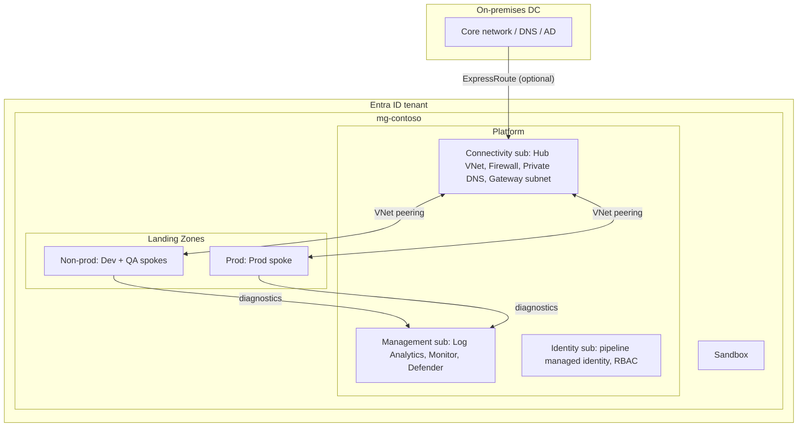
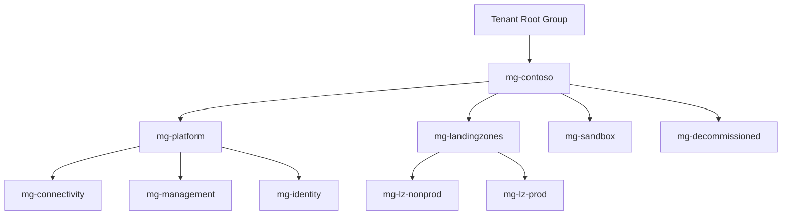
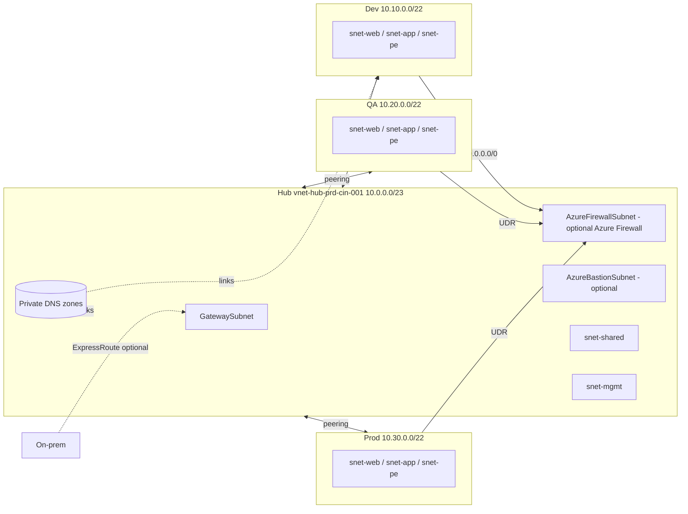
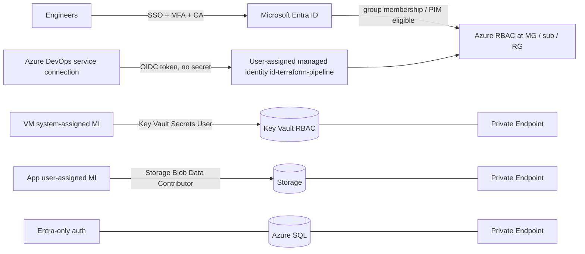
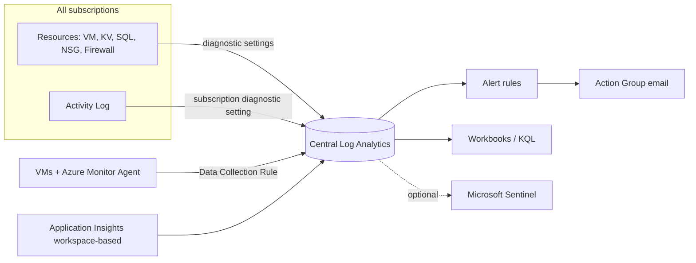
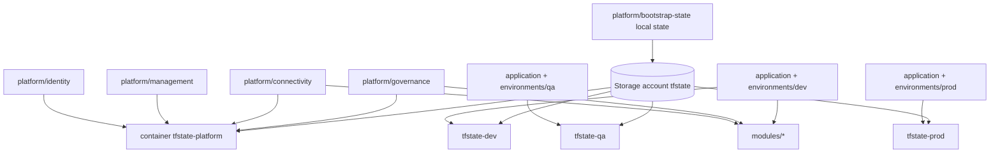
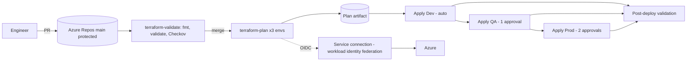
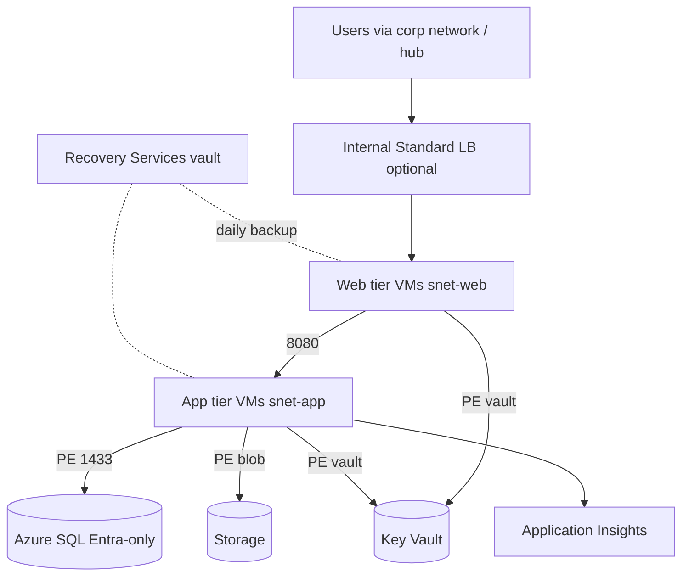

# Low-Level Design: Enterprise Azure Landing Zone

| Field | Value |
|---|---|
| Customer | Contoso (fictional training customer) |
| Version / Status | 0.1 DRAFT for customer review |
| Region | Central India (`centralindia`), paired DR region South India |
| Implementation | Terraform (`~> 1.9`) + AzureRM (`~> 4.14`), Azure DevOps |

> **Honesty note.** The Terraform in this repository has been statically checked (format + wiring) but **not deployed to Azure by the author of this repository**. Treat every "Validation" section as a plan to execute, not a record of results.

## 1. Document purpose
Defines the detailed technical design of the Azure Landing Zone and a sample three-tier workload for the migration of 50 applications from the on-premises data centre. It is the build specification for engineers and the artefact for customer sign-off.

## 2. Business requirements
| ID | Requirement |
|---|---|
| BR-01 | Migrate 50 applications from on-premises to Azure |
| BR-02 | Separate Dev, QA and Production |
| BR-03 | Central governance and compliance |
| BR-04 | Private connectivity to on-premises (ExpressRoute) |
| BR-05 | Central traffic inspection |
| BR-06 | Auditability and centralised logging |
| BR-07 | Backup, business continuity and DR |
| BR-08 | Repeatable, auditable deployment (IaC + CI/CD) |

## 3. Technical requirements
TR-01 Hub-spoke topology. TR-02 No public IPs on workloads. TR-03 PaaS accessed via Private Endpoints. TR-04 Entra ID + Azure RBAC, no standing privileged access. TR-05 No secrets in code or pipelines. TR-06 Policy-enforced guard-rails. TR-07 Central Log Analytics. TR-08 Remote, locked, isolated Terraform state.

## 4. Scope and exclusions
**In scope:** management groups, subscriptions model, hub-spoke network, optional firewall/Bastion, private DNS, Key Vault, storage, SQL, VMs, optional ILB, monitoring, backup, policy, CI/CD, documentation.
**Out of scope / documented only:** ExpressRoute circuit and provider provisioning, VPN gateway deployment, Azure Site Recovery replication, application code, data migration (Azure Migrate/DMS), Entra ID tenant configuration (Conditional Access, PIM settings), subscription creation (EA/MCA billing permissions).

## 5. Assumptions
1. Tenant admin can grant "Elevate access" once to create the management group hierarchy.
2. Customer has (or will procure) an ExpressRoute circuit; IP plan has no overlap with on-premises.
3. Connectivity, Management and Identity subscriptions exist; Dev/QA/Prod application subscriptions exist (single subscription is acceptable for the training lab).
4. Azure DevOps organisation with self-hosted or Managed DevOps agents is available for production (private state/Key Vault).

## 6. Dependencies
Tenant Root permissions · EA/MCA subscription creation rights · ExpressRoute provider · Azure DevOps project and service connections · on-prem BGP/DNS owners · security team approval of the firewall rule baseline.

## 7. Azure architecture overview

## 8. Landing Zone design
**Platform landing zone** = shared services owned by platform teams (Connectivity, Management, Identity subscriptions; `platform/*` Terraform). **Application landing zone** = a subscription (spoke) pre-wired to the platform where an application team deploys workloads (`application/` Terraform). Platform changes are rare and high-risk; application changes are frequent and scoped.

## 9. Management group hierarchy

Implemented in `platform/governance/main.tf` (module `management-group`).

## 10. Subscription design
| Subscription | Management group | Purpose |
|---|---|---|
| sub-connectivity | mg-connectivity | Hub VNet, firewall, gateways, private DNS |
| sub-management | mg-management | Log Analytics, alerts, Defender, state storage |
| sub-identity | mg-identity | Pipeline identity, RBAC assets |
| sub-app-dev / sub-app-qa | mg-lz-nonprod | Dev and QA spokes |
| sub-app-prod | mg-lz-prod | Production spoke |
Environment segregation = separate subscriptions + separate VNets + separate state containers + separate service connections.

**Naming:** `<type>-<workload>-<env>-<region>-<nnn>` (e.g. `rg-app1-dev-cin-001`, `vnet-spoke-dev-cin-001`). **Mandatory tags:** `environment`, `owner`, `costcenter`, `workload`, `managedby` (enforced on resource groups by policy; inherited by Modify).

## 11. Network topology

## 12. IP address allocation
| Range | Use |
|---|---|
| 10.0.0.0/23 | Hub |
| 10.10.0.0/22 | Dev spoke |
| 10.20.0.0/22 | QA spoke |
| 10.30.0.0/22 | Prod spoke |
| 10.40.0.0/14 (reserved) | Future spokes |
| Reserved: on-prem ranges | Must not overlap; confirm with network team |

## 13. Subnet design
| VNet | Subnet | CIDR | NSG | UDR |
|---|---|---|---|---|
| Hub | AzureFirewallSubnet | 10.0.0.0/26 | none (not supported) | n/a |
| Hub | AzureFirewallManagementSubnet (Basic SKU only) | 10.0.0.64/26 | none | n/a |
| Hub | AzureBastionSubnet | 10.0.0.128/26 | (platform default) | n/a |
| Hub | GatewaySubnet | 10.0.0.192/27 | none | n/a |
| Hub | snet-shared | 10.0.1.0/25 | nsg-snet-shared | no |
| Hub | snet-mgmt | 10.0.1.128/26 | nsg-snet-mgmt | no |
| Spoke (per env, X = 10/20/30) | snet-web | 10.X.0.0/26 | nsg-snet-web | to firewall* |
| Spoke | snet-app | 10.X.0.64/26 | nsg-snet-app | to firewall* |
| Spoke | snet-pe | 10.X.0.192/27 | nsg-snet-pe | no |
\* only when the firewall is deployed (`firewall_private_ip` set).

## 14. Routing design
- Spokes peer **only with the hub**. Spoke-to-spoke has no system route, so the `0.0.0.0/0 -> VirtualAppliance(firewall)` UDR forces it through the firewall.
- Spoke route tables have **BGP route propagation disabled** so ExpressRoute routes cannot bypass the firewall.
- Peering flags: `allow_forwarded_traffic = true` both sides; `allow_gateway_transit` (hub) and `use_remote_gateways` (spoke) enabled only after a gateway exists.
- Private Endpoint subnet has no UDR; Private Endpoint traffic stays on the VNet system route.

## 15. Firewall design
Azure Firewall with Firewall Policy (module `azure-firewall`). Training default **Basic** (needs management subnet + second public IP); production **Standard/Premium**, zones 1-3, DNS proxy on, diagnostics to the central workspace. Baseline rules: DNS from spokes, `dev|qa` mutual HTTPS only, FQDN-restricted outbound web. **Prod is not allowed to talk to dev/qa** (no allow rule = default deny). Optional: Premium IDPS/TLS inspection.

## 16. Private Endpoint design
One Private Endpoint per PaaS resource per environment, in `snet-pe`, with a DNS zone group registering the A record in the central zone. Implemented for Key Vault (`vault`), Storage (`blob`), SQL (`sqlServer`). PaaS public network access is disabled in all environments.

## 17. DNS architecture
Zones (`privatelink.vaultcore.azure.net`, `privatelink.blob.core.windows.net`, `privatelink.database.windows.net`) live once in the Connectivity subscription (RG `rg-privatedns-connectivity-prd-cin-001`) and are linked to the hub and each spoke. Production variant: spokes use the firewall DNS proxy (Standard+) and an Azure DNS Private Resolver forwards `corp.local` to on-prem; zones linked to the hub only.

## 18. Identity architecture

**Entra directory roles vs Azure RBAC:** directory roles (Global Administrator, Groups Administrator) govern identities/tenant objects; Azure RBAC roles (Owner, Contributor, Reader, data-plane roles) govern Azure resources. Only "Elevate access" bridges them (once, for management group bootstrap).

## 19. RBAC matrix
| Group | Scope | Role | PIM |
|---|---|---|---|
| grp-azure-platform-admins | mg-platform | Contributor | Eligible |
| grp-azure-network-ops | Connectivity sub | Network Contributor | Eligible |
| grp-azure-app-dev-contrib | Dev sub | Contributor | Permanent (non-prod) |
| grp-azure-app-prod-readers | Prod sub | Reader | Permanent |
| grp-azure-app-prod-deployers | Prod sub | Contributor | Eligible + approval |
| id-terraform-pipeline | per-subscription | Contributor (+ User Access Administrator constrained by condition if RBAC is managed) | n/a (workload identity) |
| Security team | mg-contoso | Security Reader | Permanent |
No Owner at subscription level for humans; Owner only via PIM with justification.

## 20. Security controls
| Control | Implementation |
|---|---|
| No public IPs on workloads | Policy `deny-public-ip` on `mg-landingzones`; VM module has no public IP |
| Private PaaS access | Private Endpoints + `public_network_access_enabled = false` |
| Secrets | Key Vault RBAC, no access policies, no secrets in Terraform/pipelines |
| Encryption at rest | Platform-managed keys by default; double encryption on state storage; CMK is a documented upgrade |
| Encryption in transit | TLS 1.2 minimum on Storage, SQL; HTTPS only |
| Network | NSG per subnet (default deny), firewall (optional), Bastion (optional) |
| Posture | Defender for Cloud plans opt-in (cost) |
| State | Private-by-default storage, Entra auth, versioning, soft delete, delete lock |
| Supply chain | Pinned provider/Terraform versions, checksum-verified install, Checkov in PR |

## 21. Governance and Azure Policy
| Policy | Effect | Scope | Notes |
|---|---|---|---|
| Allowed locations | Deny | mg-contoso | built-in, looked up by display name |
| Require tag on resource groups (x4 tags) | Deny | mg-contoso | built-in |
| Deny public IP | Deny | mg-landingzones | platform MG excluded by scope |
| Storage secure config (HTTPS/TLS1.2/no public blob) | Deny | mg-contoso (initiative) | custom |
| Audit Key Vault diagnostics | AuditIfNotExists | mg-contoso (initiative) | custom |
| Inherit `environment` tag from RG | Modify | mg-landingzones | identity + Tag Contributor + remediation task |
Rollout: assign with `enforce = false`, review compliance, then enforce.

## 22. Monitoring architecture

Cross-subscription centralisation: a diagnostic setting may target a workspace in another subscription (needs `Log Analytics Contributor`-level rights on the workspace for the setting's creator); policy `DeployIfNotExists` enforces it at scale.

## 23. Backup and DR
| Item | Training | Production |
|---|---|---|
| Vault redundancy | LRS | GRS (+ cross-region restore) |
| Policy | Daily, 7 days | Daily 30 d + weekly + monthly |
| VM placement | single zone/none | spread across zones 1/2 |
| SQL | PITR 7 d | zone-redundant, PITR 35 d, LTR, failover group (optional) |
| ASR | documented only | Central India -> South India replication (needs target VNet, cache storage, ASR vault) |
**Targets (proposal):** Prod RPO 15 min (SQL failover group) / 1 h (VM ASR), RTO 4 h; Non-prod best effort, RTO 24 h. See `docs/implementation/phase-13-backup-dr.md`.

## 24. Terraform implementation design

- One reusable `application/` root, parameterised per environment by `environments/<env>/terraform.tfvars` (the layered `networking/compute/database/monitoring` concerns are separate `.tf` files in one state per environment to avoid cross-state plumbing).
- Platform roots each have their own state key in the platform container.
- Backend uses Entra auth (`use_azuread_auth`), blob lease locking, versioning and soft delete.

## 25. CI/CD architecture

## 26. Application architecture

## 27. Deployment sequence
1. `platform/bootstrap-state` (local state) → 2. `platform/governance` (MGs, policy in DoNotEnforce) → 3. `platform/management` → 4. `platform/connectivity` → 5. `platform/identity` → 6. `application` Dev → QA → Prod. Optional: enable firewall/Bastion, then re-plan spokes with `firewall_private_ip`.

## 28. Validation and testing
| Test | How | Expected |
|---|---|---|
| Static | `scripts/validate-all.sh`, `scripts/check-module-wiring.py`, Checkov | clean |
| Plan | `terraform plan` per root | no unexpected changes; second plan shows no diff |
| Peering | Portal / `az network vnet peering list` | `Connected` both sides |
| DNS | `nslookup <kv>.vault.azure.net` from VM | private IP in snet-pe |
| Isolation | Connect from outside VNet to KV/SQL | refused |
| Policy | Create a public IP in a landing-zone sub | denied |
| Routing | `az network nic show-effective-route-table` | 0.0.0.0/0 → firewall IP |
| Backup | Trigger on-demand backup | job completes |
| Monitoring | KQL: `AzureActivity | take 10`; `Heartbeat | take 10` | rows present |

## 29. Risks and mitigations
| Risk | Mitigation |
|---|---|
| Policy blocks legitimate deployments | DoNotEnforce first, exemptions with expiry |
| State corruption/loss | Versioning, soft delete, GRS, delete lock |
| Over-privileged pipeline | Scoped Contributor, branch control, approvals |
| Private endpoint DNS misconfiguration | Central zones + policy + test runbook |
| Cost overrun | Opt-in expensive resources, LAW daily cap, budgets |
| IP overlap with on-prem | IP plan sign-off before build |
| Provider schema drift | Pinned versions, lock file committed, upgrade in a branch |

## 30. Rollback strategy
Terraform: revert the commit and re-apply (state versioning allows restoring a previous state blob if corrupted). Policy: set `policy_enforce = false` (instant relief). Network cut-over: keep on-prem path until validation passes; peering/UDR changes are reversible. Data resources: soft-delete/PITR/backup restore. Destroy is **not** a rollback for stateful production resources.

## 31. Customer approval and handover checklists
**Approval:** ☐ Requirements confirmed ☐ IP plan ☐ MG/subscription model ☐ Firewall rule baseline ☐ RBAC matrix ☐ Policy list and enforcement dates ☐ DR targets ☐ Cost estimate ☐ Risks accepted.
**Handover:** ☐ Repo access and branch policy ☐ Pipelines + service connections documented ☐ State account recovery procedure tested ☐ Runbooks (troubleshooting guide) ☐ Alert recipients confirmed ☐ Compliance report reviewed ☐ Knowledge-transfer sessions ☐ Open issues log.
